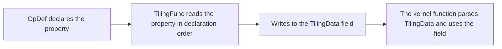

# Passing Attribute Information Through TilingData

<!-- md-trans-meta sourceCommit=7ef8ad7bdbdb0cef0f561d391759ecb8b4e4043a translatedAt=2026-10-23T13:56:34.523Z pushedAt=2026-10-28T02:56:03.873Z nl=2 -->

This document is extended content that describes the data passing method required when operator attributes participate in kernel function computation. Operator attributes are stored on the Host side and cannot be directly read by the kernel function. When an attribute needs to participate in kernel function computation, the Host-side Tiling function first reads the attribute value, then writes the data actually required by the kernel function into TilingData, which is passed to the kernel function side by the framework.

This document uses the `negative_slope` attribute of LeakyReluCustom as an example to describe how to pass attributes from the Host side to the kernel function side through TilingData, including declaring the attribute in the operator prototype, reading the attribute and writing it into TilingData on the Host side, and reading and using the attribute from TilingData on the kernel function side. For the basic definition and writing method of TilingData, see [Basic Process](./host_tiling_implementation.md).

## Property Transfer Process

The property transfer process is as follows:



Only the results required when the kernel function runs are written to TilingData. If a property affects only the host-side splitting, the number of blocks, or the TilingKey, the host side can pass the final runtime parameters after completing the computation, without passing the property as is.

## Declaring Properties in the Operator Prototype

The computation semantics of LeakyReluCustom are as follows:

$$
y =
\begin{cases}
x, & x \ge 0 \\
\text{negative\_slope} \times x, & x < 0
\end{cases}
$$

In the operator prototype, declare `negative_slope` as an optional floating-point property with a default value of `0.0f`:

```cpp
this->Attr("negative_slope")
    .AttrType(OPTIONAL)
    .Float(0.0f);
```

`OPTIONAL` indicates that the property can be omitted when the operator is called; if it is not passed in, the default value set by `Float(0.0f)` is used. For the declaration position and basic usage of properties in the prototype, see [Operator Prototype Definition](./operator_prototype_definition.md); for the parameters and default value constraints of `AttrType` and property type interfaces such as `Bool`, `Float`, and `Int`, see [OpAttrDef](../../../../../api/Utils-API/prototype_register_management/OpAttrDef/OpAttrDef_functions.md).

## Adding Fields to TilingData

When defining TilingData using standard C++ syntax, directly add fields whose types are consistent with those used on the kernel function side:

```cpp
#ifndef LEAKY_RELU_CUSTOM_TILING_H
#define LEAKY_RELU_CUSTOM_TILING_H
#include <cstdint>

struct LeakyReluCustomTilingData {
    uint32_t totalLength;
    uint32_t tileNum;
    // Save the attribute value read on the Host side for use by the kernel function in computation.
    float negativeSlope;
};

#endif // LEAKY_RELU_CUSTOM_TILING_H
```

The TilingData fields store the data passed to the kernel function and are not required to have the same names as the attributes. It is recommended to use names that directly express the purpose of the kernel function, and to choose field types that are fixed in size and can be copied directly, such as integers, floating-point numbers, booleans, or fixed-length arrays. Do not use pointers, references, or dynamic containers.

## Reading Attributes and Writing Them to TilingData in the Host-Side TilingFunc

`context->GetAttrs()` returns the attribute list of the current call. `GetAttrPointer<T>(index)` reads the corresponding value by the position of the attribute in the list, where `index` is numbered from 0 in the declaration order of `Attr` in the prototype. In this example, only one attribute, `negative_slope`, is declared, so its index is defined as 0.

The value of `negative_slope` may vary between calls. Therefore, the TilingFunc must read the attribute value of the current call instead of hardcoding it as a fixed constant in the Tiling implementation.

```cpp
namespace optiling {
constexpr uint32_t NUM_BLOCKS = 8;
constexpr uint32_t TILE_NUM = 16;
// negative_slope is the first attribute declared in the prototype, so its index is 0.
constexpr size_t NEGATIVE_SLOPE_INDEX = 0;

static ge::graphStatus TilingFunc(gert::TilingContext* context)
{
    LeakyReluCustomTilingData* tiling =
        context->GetTilingData<LeakyReluCustomTilingData>();
    uint32_t totalLength =
        context->GetInputShape(0)->GetOriginShape().GetShapeSize();

    // Read negative_slope by attribute index. The template parameter float must be consistent with the
    // Float attribute type in the prototype.
    const gert::RuntimeAttrs* attrs = context->GetAttrs();
    const float* negativeSlope =
        attrs->GetAttrPointer<float>(NEGATIVE_SLOPE_INDEX);
    if (negativeSlope == nullptr) {
        return ge::GRAPH_FAILED;
    }

    context->SetSimdNumBlocks(NUM_BLOCKS);
    tiling->totalLength = totalLength;
    tiling->tileNum = TILE_NUM;
    // Write the attribute value to TilingData so that it is passed to the kernel function side together with other runtime parameters.
    tiling->negativeSlope = *negativeSlope;

    size_t* currentWorkspace = context->GetWorkspaceSizes(1);
    currentWorkspace[0] = 0;
    return ge::GRAPH_SUCCESS;
}
} // namespace optiling
```

Even if the attribute has a default value defined in the prototype, it is still recommended to perform a null check after reading it, to avoid directly dereferencing an invalid pointer when the index, type, or project version does not match.

### Property Type Mapping

The template parameter of `GetAttrPointer<T>` must match the property type declared in the prototype.

| Prototype Property Interface | Host-Side Read Type | Type Suitable for Writing to TilingData |
|---|---|---|
| `.Bool(...)` | `bool` | `bool` or an integer of explicit width |
| `.Float(...)` | `float` | `float` |
| `.Int(...)` | An integer type consistent with the interface convention | Convert after checking the range as required by the kernel function |

A mismatch in the property read type causes data parsing errors. Before converting an integer property to a narrower type such as `uint32_t`, check for negative values and overflow range.

### Multi-Attribute Scenario

Assume the prototype declares two attributes in the following order:

```cpp
this->Attr("axis").AttrType(REQUIRED).Int();
this->Attr("keep_dims").AttrType(OPTIONAL).Bool(false);
```

On the Host side, use indexes 0 and 1 correspondingly:

```cpp
const gert::RuntimeAttrs* attrs = context->GetAttrs();
const int64_t* axis = attrs->GetAttrPointer<int64_t>(0);
const bool* keepDims = attrs->GetAttrPointer<bool>(1);
if (axis == nullptr || keepDims == nullptr) {
    return ge::GRAPH_FAILED;
}
```

When adding, deleting, or reordering attributes, you need to synchronously check all `GetAttrPointer(index)` calls. It is recommended to define named constants for indexes to avoid scattering numeric literals throughout the Tiling function.

## Using Properties on the Kernel Function Side

After the kernel function entry parses TilingData, it passes the property fields to the kernel function implementation class:

```cpp
constexpr uint32_t STATIC_TILE_LENGTH = 64;

extern "C" __global__ __aicore__ void leaky_relu_custom(
    GM_ADDR x, GM_ADDR y,
    GM_ADDR workspace, GM_ADDR tiling)
{
    // Register and parse the default TilingData, where negativeSlope is written by the Host side.
    REGISTER_TILING_DEFAULT(LeakyReluCustomTilingData);
    GET_TILING_DATA(tilingData, tiling);

    KernelLeakyRelu<STATIC_TILE_LENGTH> op;
    // Pass the parsed property value to the kernel function implementation class.
    op.Init(x, y, tilingData.totalLength, tilingData.tileNum,
            tilingData.negativeSlope);
    op.Process();
}
```

`Init` saves `negativeSlope` as a member of the kernel function class. The accompanying sample uses `Maxs`, `Mins`, `Muls`, and `Add` to implement LeakyRelu:

```cpp
float inputVal = 0.0f;

// Obtain the non-negative part and the negative part of the input separately.
AscendC::Maxs(tmpTensor1, xLocal, inputVal, tileLength);
AscendC::Mins(tmpTensor2, xLocal, inputVal, tileLength);
// Multiply the negative part by negativeSlope, and then add it to the non-negative part.
AscendC::Muls(
    tmpTensor2, tmpTensor2, this->negativeSlope, tileLength);
AscendC::Add(yLocal, tmpTensor1, tmpTensor2, tileLength);
```

The preceding computation is equivalent to:

```text
tmpTensor1 = max(x, 0)
tmpTensor2 = min(x, 0) * negativeSlope
y = tmpTensor1 + tmpTensor2
```

After the computation is complete, write `yLocal` back to Global Memory following the basic kernel function flow. In the sample, the property value is read only once in `Init`, and TilingData is not parsed repeatedly in the Tile loop.

If a property is used only on the Host side to select a TilingKey, for example, selecting different kernel function branches based on the `algorithm` property, you can directly call `context->SetTilingKey(...)` without adding an extra TilingData field. For details about branch organization, see [Multi-Branch Strategy](./multi_branch_strategy.md).

## Related Documents

- [Operator Prototype Definition](./operator_prototype_definition.md): Declares properties and their default values.
- [Host-Side Tiling Implementation](./host_tiling_implementation.md): Defines and writes TilingData.
- [Kernel Function (Kernel) Side Operator Implementation](./kernel_operator_implementation.md): Registers, parses, and uses TilingData.
- [Multi-Branch Strategy](./multi_branch_strategy.md): Uses properties to select a TilingKey or a kernel function template branch.
