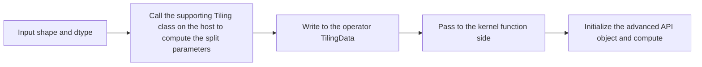

# Tiling Implementation for Advanced APIs

<!-- md-trans-meta sourceCommit=7ef8ad7bdbdb0cef0f561d391759ecb8b4e4043a translatedAt=2026-10-23T13:59:02.153Z pushedAt=2026-10-28T02:56:57.129Z nl=2 -->

This document is extended content that describes the Host-side Tiling implementation for advanced APIs. Advanced APIs such as Matmul and Conv usually provide matching Host-side Tiling classes for computing split parameters based on shape and dtype. Developers need to pass the computation results of the matching Tiling classes to the kernel function side and use the same data to initialize the advanced API objects.

This document constructs a simplified aclnn engineering operator MatmulCustom as an example. This operator only computes `C = A * B` and is used to illustrate how `MultiCoreMatmulTiling` and `TCubeTiling` are integrated into an operator project. It does not include Bias, activation functions, or multi-branch logic.

## Data Flow of Advanced API Tiling

The supporting process is as follows:



The supporting Tiling class computes the multi-core split and intra-core split parameters used inside the advanced API, and the operator TilingData passes the computation results to the kernel function side.

## Defining TilingData That Contains TCubeTiling

The Tiling structure of a advanced API can be organized using the standard C++ approach or the macro definition approach. To demonstrate how to use `TILING_DATA_FIELD_DEF_STRUCT`, this example uses the macro definition approach to nest `TCubeTiling`:

```cpp
#ifndef MATMUL_CUSTOM_TILING_H
#define MATMUL_CUSTOM_TILING_H
#include "register/tilingdata_base.h"
#include "tiling/tiling_api.h"

namespace optiling {
BEGIN_TILING_DATA_DEF(MatmulCustomTilingData)
    TILING_DATA_FIELD_DEF_STRUCT(TCubeTiling, cubeTilingData);
END_TILING_DATA_DEF;

REGISTER_TILING_DATA_CLASS(MatmulCustom, MatmulCustomTilingData)
} // namespace optiling
#endif // MATMUL_CUSTOM_TILING_H
```

`TILING_DATA_FIELD_DEF_STRUCT` can only nest Tiling structures defined by macros of the same kind. Therefore, when this macro is selected, the outer `MatmulCustomTilingData` must also be defined using the macro approach. When the standard C++ approach is used, you can directly declare the `AscendC::tiling::TCubeTiling` field in a regular structure without using the preceding macro.

The macro definition approach generates interfaces such as `SaveToBuffer()` and `GetDataSize()`. After the Host-side computation is complete, you need to explicitly serialize the TilingData.

## Calling the Companion Tiling Class in TilingFunc

In this example, A is fixed to `[512, 128]`, B to `[128, 512]`, and output C to `[512, 512]`. A and B use `float16`, C uses `float`, and all cubes are in ND format.

```cpp
#include "../op_kernel/matmul_custom_tiling.h"
#include "register/op_def_registry.h"
#include "tiling/tiling_api.h"

namespace optiling {
static ge::graphStatus TilingFunc(gert::TilingContext* context)
{
    constexpr int32_t M = 512;
    constexpr int32_t N = 512;
    constexpr int32_t K = 128;
    constexpr uint32_t NUM_BLOCKS = 2;

    // Initialize the companion Tiling class with the platform information of the current chip.
    auto platform =
        platform_ascendc::PlatformAscendC(context->GetPlatformInfo());
    matmul_tiling::MultiCoreMatmulTiling matmulTiling(platform);

    // Specify the number of cores that can be used. A and B are in GM, using ND format and float16.
    // The last parameter false of SetAType and SetBType indicates that the cubes are not transposed.
    matmulTiling.SetDim(NUM_BLOCKS);
    matmulTiling.SetAType(
        matmul_tiling::TPosition::GM,
        matmul_tiling::CubeFormat::ND,
        matmul_tiling::DataType::DT_FLOAT16,
        false);
    matmulTiling.SetBType(
        matmul_tiling::TPosition::GM,
        matmul_tiling::CubeFormat::ND,
        matmul_tiling::DataType::DT_FLOAT16,
        false);
    matmulTiling.SetCType(
        matmul_tiling::TPosition::GM,
        matmul_tiling::CubeFormat::ND,
        matmul_tiling::DataType::DT_FLOAT);
    // Configure the original shape, the shape for this computation, the Bias switch, and the buffer space.
    matmulTiling.SetOrgShape(M, N, K);
    matmulTiling.SetShape(M, N, K);
    matmulTiling.EnableBias(false);
    matmulTiling.SetBufferSpace(-1, -1, -1);

    // Compute the multi-core splitting and intra-core splitting parameters required by the Matmul advanced API.
    MatmulCustomTilingData tiling;
    if (matmulTiling.GetTiling(tiling.cubeTilingData) == -1) {
        return ge::GRAPH_FAILED;
    }
    int32_t usedCoreNum = tiling.cubeTilingData.get_usedCoreNum();
    if (usedCoreNum <= 0) {
        return ge::GRAPH_FAILED;
    }

    // Serialize the computed TCubeTiling into the TilingData buffer provided by the framework.
    tiling.SaveToBuffer(context->GetRawTilingData()->GetData(),
                        context->GetRawTilingData()->GetCapacity());
    context->GetRawTilingData()->SetDataSize(tiling.GetDataSize());

    // The number of cores used to launch the kernel function must be consistent with the actual number of cores used in the Tiling result.
    context->SetSimdNumBlocks(static_cast<uint32_t>(usedCoreNum));

    // The system workspace is used for internal computation by the advanced API and is added to the operator's custom workspace.
    size_t userWorkspaceSize = 0;
    size_t systemWorkspaceSize =
        static_cast<size_t>(platform.GetLibApiWorkSpaceSize());
    size_t* currentWorkspace = context->GetWorkspaceSizes(1);
    currentWorkspace[0] = systemWorkspaceSize + userWorkspaceSize;
    return ge::GRAPH_SUCCESS;
}
} // namespace optiling
```

The example uses fixed shapes to highlight the interfaces of the companion tiling class. When dynamic shapes are supported, read `M`, `N`, and `K` from `TilingContext`, and verify the rank, the equality of the K dimensions, and the integer conversion range before calling `GetTiling`.

### Setting the Workspace

The Matmul advanced API may require a system workspace. On the host side, obtain the system workspace size by calling `GetLibApiWorkSpaceSize()` and add it to the operator's custom workspace:

```cpp
size_t userWorkspaceSize = 0;
size_t systemWorkspaceSize =
    static_cast<size_t>(platform.GetLibApiWorkSpaceSize());
size_t* currentWorkspace = context->GetWorkspaceSizes(1);
currentWorkspace[0] = systemWorkspaceSize + userWorkspaceSize;
```

Even if the operator has no custom temporary data, you still need to check whether the advanced API uses a system workspace. Do not directly set the workspace to 0.

For the general method of setting the system workspace and user workspace, see [How to Use the Workspace](../../../appendix/common_operations/how_to_use_workspace.md).

### Validating Input Conditions

Before calling `GetTiling`, an actual operator also needs to validate the following:

- Whether A and B are two-dimensional cubes.
- Whether the K dimension of A is equal to the K dimension of B.
- Whether the input dtype and format are consistent with the `SetAType` and `SetBType` configurations.
- Whether the output shape, dtype, and format are consistent with the `SetCType` configuration.
- Whether `M`, `N`, and `K` exceed the range before being converted to `int32_t`.

If validation fails, return `ge::GRAPH_FAILED` and do not continue to compute Tiling with invalid shapes.

## Using TCubeTiling on the Kernel Side

The kernel function entry parses the TilingData and uses the `TCubeTiling` in it to register the Matmul object:

```cpp
#include "kernel_operator.h"
#define ASCENDC_CUBE_ONLY
#include "lib/matmul_intf.h"

using namespace matmul;

extern "C" __global__ __aicore__ void matmul_custom(
    GM_ADDR a, GM_ADDR b, GM_ADDR c,
    GM_ADDR workspace, GM_ADDR tiling)
{
    GET_TILING_DATA(tilingData, tiling);

    AscendC::TPipe pipe;
    AscendC::GlobalTensor<half> aGlobal;
    AscendC::GlobalTensor<half> bGlobal;
    AscendC::GlobalTensor<float> cGlobal;
    aGlobal.SetGlobalBuffer(
        reinterpret_cast<__gm__ half*>(a),
        tilingData.cubeTilingData.M * tilingData.cubeTilingData.Ka);
    bGlobal.SetGlobalBuffer(
        reinterpret_cast<__gm__ half*>(b),
        tilingData.cubeTilingData.Kb * tilingData.cubeTilingData.N);
    cGlobal.SetGlobalBuffer(
        reinterpret_cast<__gm__ float*>(c),
        tilingData.cubeTilingData.M * tilingData.cubeTilingData.N);

    // The position, format, and data type in the template parameters must be consistent with the Tiling configuration on the host side.
    Matmul<
        MatmulType<AscendC::TPosition::GM, CubeFormat::ND, half>,
        MatmulType<AscendC::TPosition::GM, CubeFormat::ND, half>,
        MatmulType<AscendC::TPosition::GM, CubeFormat::ND, float>> mm;

    // Use the system workspace and TCubeTiling to register the Matmul object.
    REGIST_MATMUL_OBJ(
        &pipe, GetSysWorkSpacePtr(), mm,
        &tilingData.cubeTilingData);

    // Set M, N, Ka, and Kb of the original cubes.
    mm.SetOrgShape(
        tilingData.cubeTilingData.M,
        tilingData.cubeTilingData.N,
        tilingData.cubeTilingData.Ka,
        tilingData.cubeTilingData.Kb);

    uint64_t blockIdx = static_cast<uint64_t>(AscendC::GetBlockIdx());
    uint64_t aOffset =
        blockIdx * tilingData.cubeTilingData.singleCoreM *
        tilingData.cubeTilingData.Ka;
    uint64_t cOffset =
        blockIdx * tilingData.cubeTilingData.singleCoreM *
        tilingData.cubeTilingData.N;

    mm.SetTensorA(aGlobal[aOffset], false);
    mm.SetTensorB(bGlobal[0], false);
    mm.IterateAll(cGlobal[cOffset]);
    mm.End();
}
```

The position, format, and dtype configured by `SetAType`, `SetBType`, and `SetCType` on the host side must be consistent with the `MatmulType` template parameters on the kernel function side. In this example, cores are split along the M axis: different blocks read different rows of A, reuse the complete cube B, and write the results to the corresponding rows of C.

## Related Documents

- [Host-Side Tiling Implementation](./host_tiling_implementation.md): basic process of common TilingData and Tiling functions.
- [Kernel-Side Operator Implementation](./kernel_operator_implementation.md): kernel function entry, TilingData parsing, and kernel function programming process.
- [Matmul-Tiling Class](../../../../../api/SIMD-API/adv_api/cube_compute/Matmul_Tiling/Matmul_Tiling.md): description of the companion Tiling class APIs.
