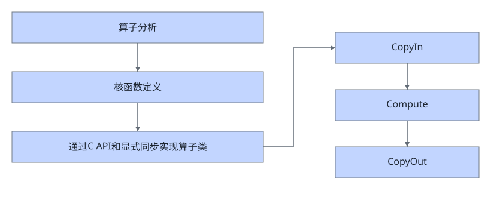
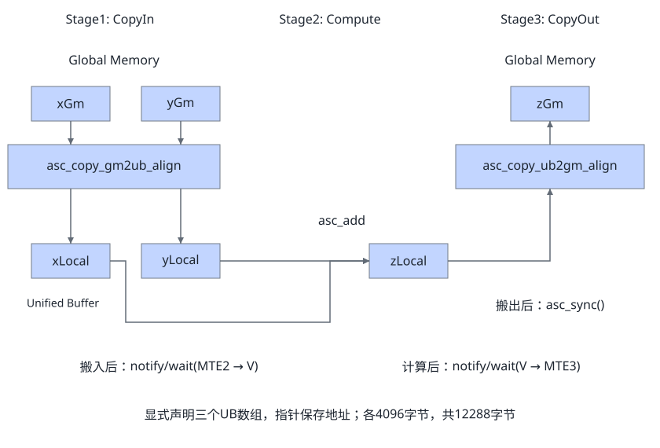

# 基础矢量算子

基于Ascend C的C API方式实现基础矢量算子核函数（Kernel）的流程如下图所示。

**图1**  矢量算子核函数（Kernel）实现流程    



-   算子分析：分析算子的数学表达式、输入、输出以及计算逻辑的实现，明确需要调用的C API。
-   核函数（Kernel）定义：定义Ascend C算子入口函数。
-   通过C API和显式同步实现算子类：完成核函数（Kernel）的内部实现，包括3个基本任务：CopyIn，Compute，CopyOut。

下文以输入为half数据类型且shape的最后一维为32Bytes对齐、在单核上运行的、一次完成计算的Add算子为例，对上述步骤进行详细介绍。

## 算子分析<a id="basic_vector_analysis"></a>

算子分析具体步骤如下：

1.  明确算子的数学表达式及计算逻辑。

    Add算子的数学表达式为：

    ```text
    z = x + y
    ```

    计算逻辑是：C API提供的[矢量计算接口](../../../../api/SIMD-API/c_api/reg_compute/reg_arith/asc_add.md)通过寄存器加载、计算和存储接口访问UB中的操作元素，输入数据需要先从外部存储（Global Memory）搬运到Unified Buffer（UB），然后使用计算接口完成两个输入参数相加，得到最终结果，再搬出到外部存储上。Ascend C  Add算子的计算逻辑如下图所示。

    **图2**  算子计算逻辑    
    

2.  明确输入和输出。

    -   Add算子有两个输入：x与y；输出为z。

    -   本样例中算子的输入支持的数据类型为half（float16），算子输出的数据类型与输入的数据类型相同。

    -   算子输入支持的shape为（1，2048），输出shape与输入shape相同。

    -   算子输入支持的[format](../../../technical_appendix/concepts_and_terms/neural_networks_and_operators/data_layout.md)为：ND。

3.  确定核函数（Kernel）名称和参数。

    -   您可以自定义核函数（Kernel）名称，本样例中核函数（Kernel）命名为vector\_add\_custom。

    -   根据对算子输入输出的分析，确定核函数（Kernel）有3个参数x，y，z；x，y为输入在Global Memory上的内存地址，z为输出在Global Memory上的内存地址。

4.  确定算子实现所需接口。

    -   实现涉及外部存储和内部存储间的数据搬运，查看Ascend C  API参考中的数据搬运接口，需要使用[asc_copy_gm2ub_align](../../../../api/SIMD-API/c_api/vector_datamove/asc_copy_gm2ub_align/asc_copy_gm2ub_align_arch_3510.md)和[asc_copy_ub2gm_align](../../../../api/SIMD-API/c_api/vector_datamove/asc_copy_ub2gm_align/asc_copy_ub2gm_align_arch_3510.md)来实现数据搬运。

    -   本样例只涉及矢量计算的加法操作，查看Ascend C  API参考中的[矢量计算](../../../../api/SIMD-API/c_api/reg_compute/reg_compute.md)接口，初步分析可使用基础算术Add接口[asc_add](../../../../api/SIMD-API/c_api/reg_compute/reg_arith/asc_add.md)实现x+y。

    -   使用显式声明的UB数组管理计算中使用的数据，通过[asc_sync_notify](../../../../api/SIMD-API/c_api/sync/intra_core_sync/asc_sync_notify.md)、[asc_sync_wait](../../../../api/SIMD-API/c_api/sync/intra_core_sync/asc_sync_wait.md)等接口完成跨流水同步。

通过以上分析，得到Ascend C  Add算子的设计规格如下：

-   算子类型（OpType）：Add
-   算子输入输出：

    **表1**  Add算子输入输出规格

    | name | shape | data type | format |
    | --- | --- | --- | --- |
    | x（输入） | (1, 2048) | half | ND |
    | y（输入） | (1, 2048) | half | ND |
    | z（输出） | (1, 2048) | half | ND |

-   核函数（Kernel）名称：vector\_add\_custom
-   使用的主要接口：

    -   asc_copy_gm2ub_align、asc_copy_ub2gm_align：数据搬移接口

    -   asc_add：矢量基础算术接口

    -   asc_sync_notify、asc_sync_wait等接口：跨流水同步接口

    -   asc_init：核内控制状态初始化接口

    -   asc_sync：核内全流水同步接口

-   算子实现文件名称：vector\_add.asc

## 核函数（Kernel）定义

根据[核函数（Kernel）](../../../programming_guide/programming_model/ai_core_simd_programming/kernel_function.md)中介绍的规则进行核函数（Kernel）的定义。

1.  函数原型定义

    本样例中，函数名为vector\_add\_custom（核函数（Kernel）名称可自定义），根据[算子分析](#basic_vector_analysis)中对算子输入输出的分析，确定有3个参数x，y，z，其中x，y为输入内存，z为输出内存。根据[核函数（Kernel）](../../../programming_guide/programming_model/ai_core_simd_programming/kernel_function.md#zh-cn_topic_0000001447989210_section1915102519220)的规则介绍，函数原型定义如下所示：使用\_\_global\_\_函数类型限定符标识它是一个核函数（Kernel），可以被<<<\>\>\>调用；使用\_\_vector\_\_函数类型限定符标识该核函数（Kernel）在设备端aicore的Vector Core上执行。

    ```cpp
    __global__ __vector__ void vector_add_custom(__gm__ uint8_t* x, __gm__ uint8_t* y, __gm__ uint8_t* z)
    {
    }
    ```

2.  调用算子类的Init和Process函数。

    算子类的Init函数，完成内存初始化相关工作，Process函数完成算子实现的核心逻辑，具体介绍参见[算子类实现](#basic_vector_class)。

    ```cpp
    __global__ __vector__ void vector_add_custom(__gm__ uint8_t* x, __gm__ uint8_t* y, __gm__ uint8_t* z)
    {
        asc_init();
        __ubuf__ half xLocal[TOTAL_LENGTH];
        __ubuf__ half yLocal[TOTAL_LENGTH];
        __ubuf__ half zLocal[TOTAL_LENGTH];
        KernelAdd op;
        op.Init(x, y, z, xLocal, yLocal, zLocal);
        op.Process();
        asc_sync();
    }
    ```

3.  根据[核函数（Kernel）定义和调用](../../../programming_guide/programming_model/ai_core_simd_programming/kernel_function.md#zh-cn_topic_0000001447989210_section1915102519220)章节，调用核函数（Kernel）时，除了需要传入参数x，y，z，还需要传入numBlocks（核函数（Kernel）执行的核数）、动态UB大小（无动态UB需求时设置为0）、stream（应用程序中维护异步操作执行顺序的stream）来规定核函数（Kernel）的执行配置。

    ```cpp
    vector_add_custom<<<numBlocks, 0, stream>>>(xDevice, yDevice, zDevice);
    ```

## 算子类实现<a id="basic_vector_class"></a>

根据上一节介绍，核函数（Kernel）中会调用算子类的Init和Process函数，本节具体讲解如何通过C API和显式同步实现算子类。

通过C API和显式同步对Add算子的实现流程进行设计的思路如下，设计完成后得到的Add算子实现流程图参见[图3 Add算子实现流程](#basic_vector_stages)：

-   Add算子的实现流程分为3个基本任务：CopyIn，Compute，CopyOut。CopyIn任务负责将Global Memory上的输入指针xGm和yGm搬运至Local Memory，分别存储在xLocal，yLocal，Compute任务负责对xLocal，yLocal执行加法操作，计算结果存储在zLocal中，CopyOut任务负责将输出数据从zLocal搬运至Global Memory上的输出指针zGm中。
-   CopyIn，Compute任务间通过MTE2到V的notify/wait事件进行同步，Compute，CopyOut任务间通过V到MTE3的notify/wait事件进行同步。
-   任务间交互使用到的内存、临时变量的内存使用显式声明的UB数组进行管理，算子类保存其地址。

**图3**  Add算子实现流程<a id="basic_vector_stages"></a>    



算子类中主要实现上述流程，包含对外开放的初始化Init函数和核心处理函数Process，Process函数中会对上图中的三个基本任务进行调用；同时包括一些算子实现中会用到的私有成员，比如上图中的GM指针（xGm、yGm、zGm）和UB指针（xLocal、yLocal、zLocal）等。KernelAdd算子类具体成员如下：

```cpp
#include <cstdint>
#include "c_api/asc_simd.h"

constexpr int32_t TOTAL_LENGTH = 1 * 2048;  // 数据总长
constexpr uint32_t TOTAL_BYTES = TOTAL_LENGTH * sizeof(half);  // 搬运字节数

class KernelAdd {
public:
    __aicore__ inline KernelAdd() {}
    // 初始化函数，完成内存地址初始化相关操作
    __aicore__ inline void Init(__gm__ uint8_t* x, __gm__ uint8_t* y, __gm__ uint8_t* z,
        __ubuf__ half* xBuffer, __ubuf__ half* yBuffer, __ubuf__ half* zBuffer);
    // 核心处理函数，实现算子逻辑，调用私有成员函数CopyIn、Compute、CopyOut完成矢量算子的三级流水操作
    __aicore__ inline void Process()
    {
        CopyIn();
        Compute();
        CopyOut();
    }

private:
    // 搬入函数，完成CopyIn阶段的处理，被核心Process函数调用
    __aicore__ inline void CopyIn();
    // 计算函数，完成Compute阶段的处理，被核心Process函数调用
    __aicore__ inline void Compute();
    // 搬出函数，完成CopyOut阶段的处理，被核心Process函数调用
    __aicore__ inline void CopyOut();

private:
    __gm__ half* xGm;  // 输入输出Global Memory内存地址，其中xGm、yGm为输入，zGm为输出
    __gm__ half* yGm;
    __gm__ half* zGm;
    __ubuf__ half* xLocal;  // 输入x的UB数组地址
    __ubuf__ half* yLocal;  // 输入y的UB数组地址
    __ubuf__ half* zLocal;  // 输出z的UB数组地址
};
```

初始化函数主要完成以下内容：

-   设置输入输出指针的Global Memory内存地址。

    本样例中的分配方案是：数据整体长度TOTAL\_LENGTH为1 \* 2048，通过指针转换设定该核上Global Memory的起始地址，并使用TOTAL_LENGTH记录数据长度。

    ```cpp
    xGm = reinterpret_cast<__gm__ half*>(x);
    ```

-   通过核函数中显式声明的UB数组为输入输出分配内存，并在Init中保存其地址。

    比如，保存输入x的UB数组地址，可以通过如下代码段实现：

    ```cpp
    xLocal = xBuffer;
    ```

具体的初始化函数代码如下：

```cpp
__aicore__ inline void KernelAdd::Init(__gm__ uint8_t* x, __gm__ uint8_t* y, __gm__ uint8_t* z,
    __ubuf__ half* xBuffer, __ubuf__ half* yBuffer, __ubuf__ half* zBuffer)
{
    // 设置Global Memory的起始地址以及长度，长度由TOTAL_LENGTH记录
    xGm = reinterpret_cast<__gm__ half*>(x);
    yGm = reinterpret_cast<__gm__ half*>(y);
    zGm = reinterpret_cast<__gm__ half*>(z);

    // 保存核函数中已分配的输入输出UB数组地址
    xLocal = xBuffer;
    yLocal = yBuffer;
    zLocal = zBuffer;
}
```

通过C API和显式同步，将核函数（Kernel）的实现分为3个基本任务：CopyIn，Compute，CopyOut。再根据上面的算法分析，将整个计算拆分成三个Stage，用户单独编写每个Stage的代码，三阶段流程示意图参见[图3](#basic_vector_stages)，具体流程如下：

1.  Stage1：CopyIn实现。

    1.  使用[asc_copy_gm2ub_align](../../../../api/SIMD-API/c_api/vector_datamove/asc_copy_gm2ub_align/asc_copy_gm2ub_align_arch_3510.md)接口将GM数据拷贝到UB数组。
    2.  使用asc_sync_notify、asc_sync_wait建立MTE2到V的依赖，保证搬入完成后才能计算。

    ```cpp
    __aicore__ inline void KernelAdd::CopyIn()
    {
        // 将Global Memory数据拷贝到UB数组
        asc_copy_gm2ub_align(xLocal, xGm, TOTAL_BYTES);
        asc_copy_gm2ub_align(yLocal, yGm, TOTAL_BYTES);
        // 等待输入数据搬入完成
        asc_sync_notify(PIPE_MTE2, PIPE_V, EVENT_ID0);
        asc_sync_wait(PIPE_MTE2, PIPE_V, EVENT_ID0);
    }
    ```

2.  Stage2：Compute实现。

    1.  使用已完成搬入的UB输入数组。
    2.  使用C API接口[asc_add](../../../../api/SIMD-API/c_api/reg_compute/reg_arith/asc_add.md)完成矢量计算。
    3.  使用asc_sync_notify、asc_sync_wait建立V到MTE3的依赖，保证计算完成后才能搬出。
    4.  输入UB数组在本次计算后不再使用，其空间保留到核函数结束，无需调用释放接口。

    ```cpp
    __aicore__ inline void KernelAdd::Compute()
    {
        // 调用Add算子进行计算
        asc_vf_call<AddVF<half>>(zLocal, xLocal, yLocal, TOTAL_LENGTH);
        // 等待计算完成后再搬出结果
        asc_sync_notify(PIPE_V, PIPE_MTE3, EVENT_ID0);
        asc_sync_wait(PIPE_V, PIPE_MTE3, EVENT_ID0);
    }
    ```

3.  Stage3：CopyOut实现。

    1.  使用已完成计算的UB输出数组。
    2.  使用[asc_copy_ub2gm_align](../../../../api/SIMD-API/c_api/vector_datamove/asc_copy_ub2gm_align/asc_copy_ub2gm_align_arch_3510.md)接口将UB数据拷贝到GM上。
    3.  核函数退出前使用asc_sync等待搬出完成，再结束UB数组的使用。

    ```cpp
    __aicore__ inline void KernelAdd::CopyOut()
    {
        // 将计算结果从UB数组拷贝到Global Memory
        asc_copy_ub2gm_align(zGm, zLocal, TOTAL_BYTES);
        // 核函数中在Process返回后调用asc_sync，等待搬出完成
    }
    ```

## Reg矢量函数实现

上述计算通过asc_vf_call调用以下矢量函数。实际源文件中将该定义放在调用位置之前；输入UB数组须按完整VL（256字节）向上对齐预留，搬运仍只处理实际数据长度。

```cpp
#include "c_api/asc_simd.h"

template <typename T>
__simd_vf__ inline void AddVF(__ubuf__ T* dst, __ubuf__ T* x, __ubuf__ T* y, uint32_t count)
{
    uint32_t remain = count;
    for (uint32_t i = 0; i < count; i += 256 / sizeof(T)) {
        vector_bool mask;
        if constexpr (sizeof(T) == 2) {
            mask = asc_update_mask_b16(remain);
        } else {
            mask = asc_update_mask_b32(remain);
        }
        auto a = asc_loadalign(x + i);
        auto b = asc_loadalign(y + i);
        auto result = asc_add(a, b, mask);
        asc_storealign(dst + i, result, mask);
    }
}
```
