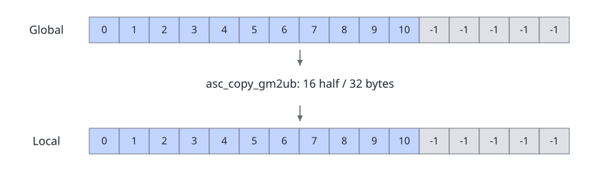
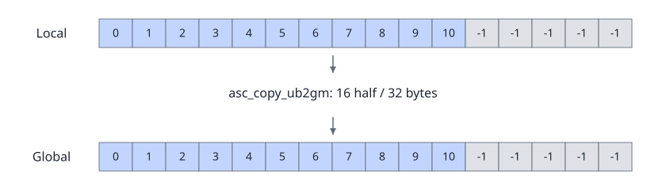
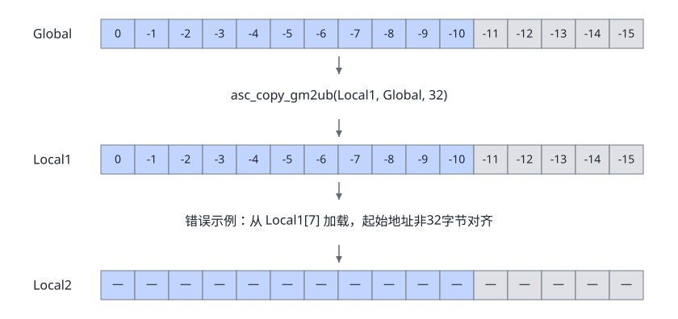
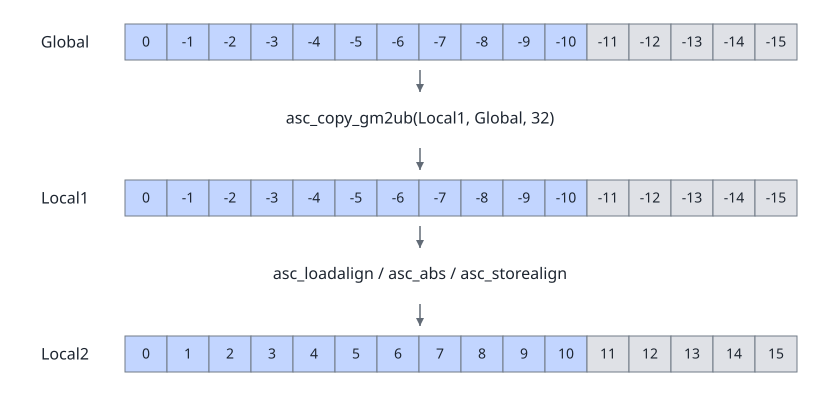
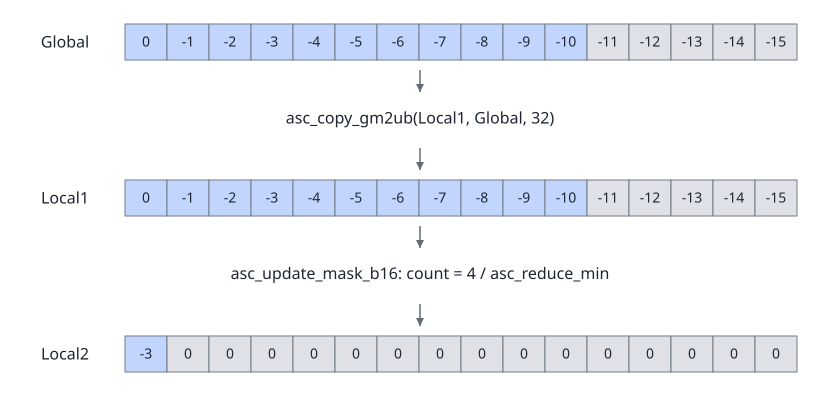
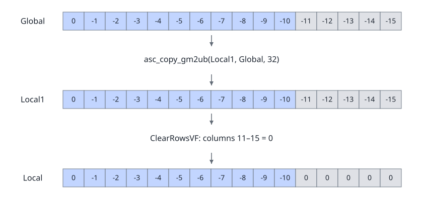
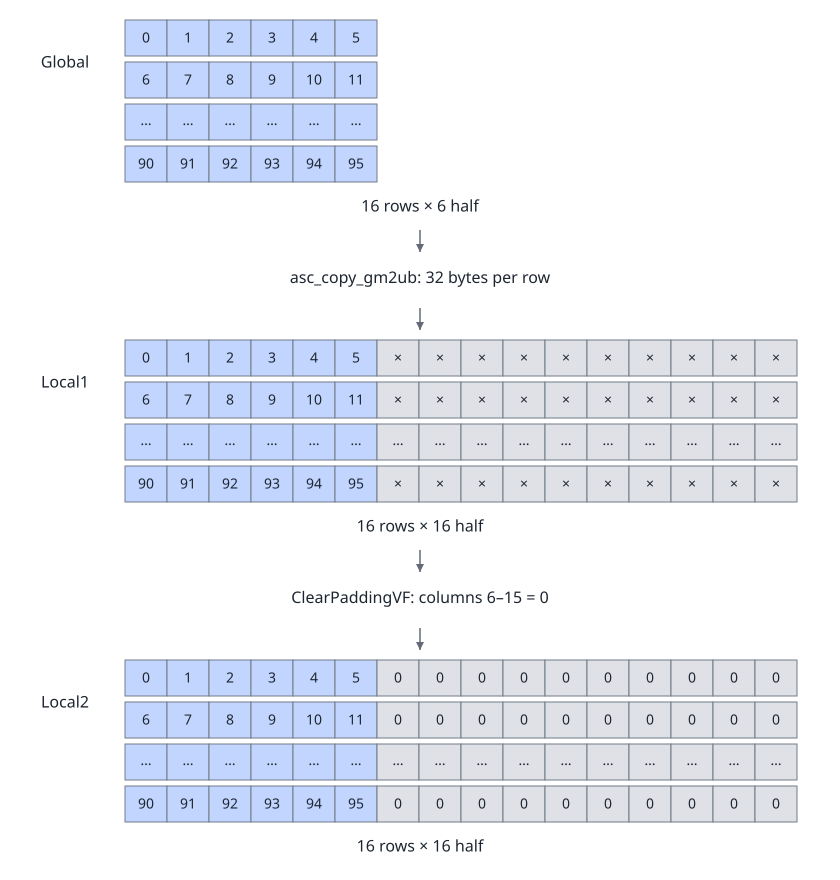
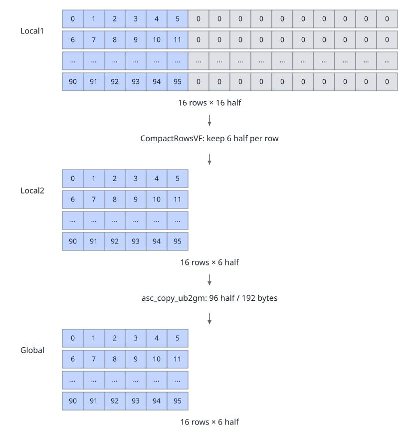
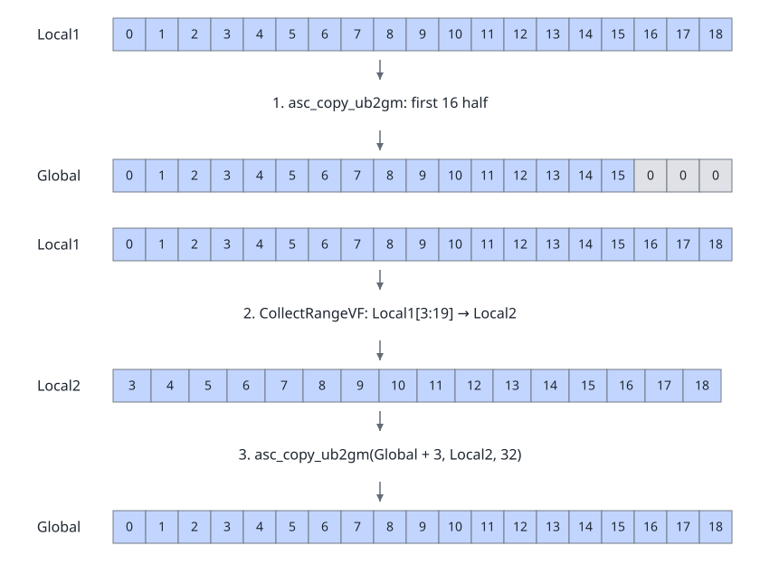

# 非对齐场景

本节介绍非32字节对齐数据的更多处理方式，包括数据搬入、计算和搬出的处理。用户在实际算子开发中，可以参考如下方案介绍和算子样例灵活地处理非对齐场景。

## 数据搬运和Vector计算的对齐要求

> [!NOTE]说明
> 进行数据搬运和Vector计算时，对于搬运的数据长度和操作数的起始地址有如下的对齐要求：
> - 本节使用NPU架构版本3510接口。GM与UB之间搬运的长度需满足数据类型的字节对齐要求，无需一律为32字节倍数；UB起始地址须满足具体接口约束。非32字节对齐搬入时，UB应预留向上补齐到32字节后的空间。
> - 通常情况下，进行Vector计算时，操作数的起始地址必须保证32字节对齐。具体对齐要求需要查阅对应的API参考进行确认。

下文描述中的Global指Global Memory上的数据，Local指Local Memory上的数据，C API中分别通过GM指针和UB指针访问。

下面是一些非对齐搬运和计算的例子。

-   **非对齐搬入**

    当需要从Global拷贝11个half数值到Local时，若主动按32字节补齐搬运长度，可使用asc_copy_gm2ub拷贝16个half（32B）数据到Local上，Local\[11\]\~Local\[15\]被写成无效数据-1。

    **图1**  非对齐搬入    

    

-   **非对齐搬出**

    当需要从Local拷贝11个half数值到Global时，若主动按32字节补齐搬运长度，可使用asc_copy_ub2gm拷贝16个half（32B）数据到Global上，Global\[11\]\~Global\[15\]被写成无效数据-1。

    **图2**  非对齐搬出    

    

-   **矢量计算起始地址非32字节对齐的错误示例**

    矢量计算时需要保证起始地址32字节对齐，如下的示例中，从Local1\[7\]，即UB数组的第8个数开始计算，起始地址不满足32字节对齐，是错误示例。

    **图3**  矢量计算起始地址非32字节对齐的错误示例    

    

## 非对齐处理方案

[asc_copy_gm2ub_align](../../../../api/SIMD-API/c_api/vector_datamove/asc_copy_gm2ub_align/asc_copy_gm2ub_align_arch_3510.md)和[asc_copy_ub2gm_align](../../../../api/SIMD-API/c_api/vector_datamove/asc_copy_ub2gm_align/asc_copy_ub2gm_align_arch_3510.md)接口提供非对齐搬运的功能，如果基于该接口支持的产品开发算子（参见产品支持情况），则可以直接使用该接口解决非对齐场景下的搬运问题。原基础API版本使用DataCopyPad的完整示例请参考[DataCopyPad样例](../../../../../../examples/01_simd_cpp_api/03_basic_api/00_data_movement/data_copy_pad_gm2ub_ub2gm/README.md)。

对于使用对齐搬运接口的场景，可以参考如下的搬运方案处理。

首先，使用asc_copy_gm2ub、asc_copy_ub2gm对齐数据搬运接口进行数据搬运，若主动将每行搬入长度向上补齐到32字节，数据长度非对齐的情况下，从Global逐行搬运Tensor数据到Local中，Local中每行都存在冗余随机数据。

搬入后，进行矢量计算时对冗余数据的处理方式有以下几种：

-   **冗余数据参与计算**。一般用于elewise计算场景，冗余数据即使参与计算，也不影响最终结果，如下图所示：

    **图4**  冗余数据参与计算    

    


-   **通过mask参数掩掉冗余数据**。一般用于轴归约计算等场景。如下图所示，为只对前4个half数据进行最小值归约计算，可以通过设置mask参数的方法掩掉冗余数据：

    **图5**  使用mask掩掉脏数据    

    

    示例片段如下：

    ```cpp
    __simd_vf__ inline void MaskMinVF(__ubuf__ half* output, __ubuf__ half* input)
    {
        vector_half value, result;
        uint32_t count = 4;
        auto mask = asc_update_mask_b16(count); // 仅前4个元素参与运算
        asc_loadalign(value, input);
        asc_reduce_min(result, value, mask);
        count = 1;
        asc_storealign(output, result, asc_update_mask_b16(count));
    }
    // 在核函数中调用：
    asc_vf_call<MaskMinVF>(output, input);
    ```


-   **通过asc_duplicate_scalar逐行清零**。计算前，针对每一行数据，调用C API [asc_duplicate_scalar](../../../../api/SIMD-API/c_api/reg_compute/reg_broadcast/asc_duplicate_scalar.md)对冗余数据位置填充0值，通过非对齐存储指定仅后5个元素位置有效，将冗余数据填充为0，如下图所示：

    **图6**  通过asc_duplicate_scalar逐行清零    

    

    示例片段如下：

    ```cpp
    __simd_vf__ inline void ClearRowsVF(__ubuf__ half* input)
    {
        auto zero = asc_duplicate_scalar(static_cast<half>(0));
        for (uint32_t row = 0; row < 16; ++row) {
            vector_store_unalign writer;
            asc_storeunalign(input + row * 16 + 11, writer, zero, 5);
            asc_storeunalign_post(input + row * 16 + 11, writer, 5);
            asc_mem_bar(VST_VST); // 等待本行存储完成，保持逐行清零的执行顺序
        }
    }
    asc_vf_call<ClearRowsVF>(input);
    ```

-   **通过asc_duplicate_scalar一次性清零**。计算前，针对多行数据，可以在一次VF调用中组合寄存器加载、asc_duplicate_scalar和非对齐存储，对多行冗余数据进行批量清零，保持原Pad示例每行6个有效half、10个填充half的布局。

    **图7**  通过asc_duplicate_scalar一次性清零    

    

    示例片段如下：

    ```cpp
    __simd_vf__ inline void ClearPaddingVF(__ubuf__ half* output, __ubuf__ half* input)
    {
        vector_store_unalign writer;
        auto zero = asc_duplicate_scalar(static_cast<half>(0));
        for (uint32_t row = 0; row < 16; ++row) {
            vector_half value;
            asc_loadalign(value, input + row * 16);
            asc_storeunalign(output + row * 16, writer, value, 6);
            asc_storeunalign(output + row * 16 + 6, writer, zero, 10);
        }
        asc_storeunalign_post(output, writer, 256);
    }
    asc_vf_call<ClearPaddingVF>(outputLocal, inputLocal);
    ```

最后，使用asc_copy_gm2ub、asc_copy_ub2gm对齐数据搬运接口进行数据搬出。若主动按32字节补齐搬出长度且满足UB起始地址要求，搬出时可以选择去除冗余数据或者带着冗余数据搬出的方式，有以下几种：

-   **使用寄存器加载与非对齐存储去除冗余数据后搬出**。待搬出的有效数据总长度满足32字节对齐时，可使用[asc_storeunalign](../../../../api/SIMD-API/c_api/reg_compute/store/asc_storeunalign.md)逐行提取前6个half以去除冗余数据并完整搬出。如下图所示：

    **图8**  使用寄存器加载与非对齐存储去除冗余数据后搬出    

    

    示例片段如下：

    ```cpp
    __simd_vf__ inline void CompactRowsVF(__ubuf__ half* output, __ubuf__ half* input)
    {
        vector_store_unalign writer;
        for (uint32_t row = 0; row < 16; ++row) {
            vector_half value;
            asc_loadalign(value, input + row * 16);
            asc_storeunalign(output + row * 6, writer, value, 6);
        }
        asc_storeunalign_post(output, writer, 96);
    }
    // 每行16个half，仅前6个有效；16行合计96个有效half。
    asc_vf_call<CompactRowsVF>(outputLocal, inputLocal);
    asc_sync_notify(PIPE_V, PIPE_MTE3, EVENT_ID0);
    asc_sync_wait(PIPE_V, PIPE_MTE3, EVENT_ID0);
    asc_copy_ub2gm(dstGlobal, outputLocal, 96 * sizeof(half));
    ```

-   **使用寄存器加载与非对齐存储收集有效数据后搬出**。待搬出的有效数据总长度大于等于32字节时，可使用[asc_storeunalign](../../../../api/SIMD-API/c_api/reg_compute/store/asc_storeunalign.md)重新收集有效数据，保证搬出的有效数据起始地址和数据长度32字节对齐。如下图所示：

    **图9**  使用寄存器加载与非对齐存储收集有效数据后搬出。    

    
    
    示例片段如下：

    ```cpp
    __simd_vf__ inline void CollectRangeVF(__ubuf__ half* tail, __ubuf__ half* input)
    {
        vector_load_unalign reader;
        vector_store_unalign writer;
        vector_half value;
        asc_loadunalign_pre(reader, input + 3);
        asc_loadunalign(value, reader, input + 3); // 收集索引3-18位置的16个half
        asc_storeunalign(tail, writer, value, 16);
        asc_storeunalign_post(tail, writer, 16);
    }
    asc_vf_call<CollectRangeVF>(tailLocal, outputLocal);
    asc_sync_notify(PIPE_V, PIPE_MTE3, EVENT_ID0);
    asc_sync_wait(PIPE_V, PIPE_MTE3, EVENT_ID0);
    asc_copy_ub2gm(dstGlobal, outputLocal, 16 * sizeof(half));
    asc_sync_pipe(PIPE_MTE3);
    asc_copy_ub2gm(dstGlobal + 3, tailLocal, 16 * sizeof(half)); // 覆盖Global索引3-18位置的数据
    ```

上述片段使用3510的寄存器接口，通过asc_vf_call调用矢量函数。其中asc_reduce_min用于归约，asc_duplicate_scalar生成零值，asc_loadalign、asc_loadunalign与asc_storeunalign组合完成数据整理，未使用2201的存储器矢量接口。

代码包含头文件`"c_api/asc_simd.h"`，并在`asc_init()`之后执行。各片段独立说明处理方法，VF函数定义须放在核函数之前，示例中的调用语句置于核函数中；输入应先完成搬入及相应同步。所有整寄存器加载都要求实际读取范围可访问：MaskMinVF至少预留128个half，ClearPaddingVF和CompactRowsVF的源缓冲区至少预留384个half，CollectRangeVF源缓冲区至少预留160个half。对齐搬运涉及的额外GM读写空间必须已分配，不能将图中的冗余空间视为可以越界访问。图中数据布局与原例保持一致，函数名称与本页实现对应。通用要求参见[概述](overview.md#c_api_usage)。
